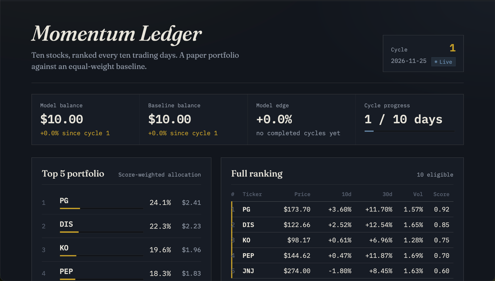
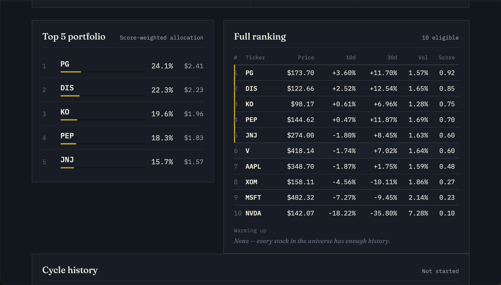
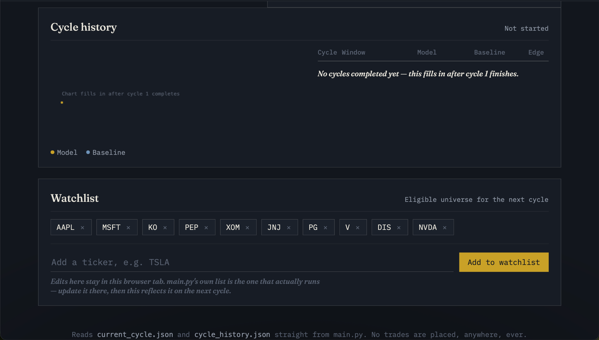
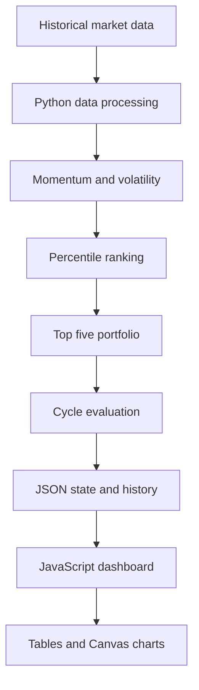

# Momentum Ledger

A quantitative stock ranking and paper portfolio simulation
system built with Python, Pandas, and vanilla JavaScript.

## Overview

Momentum Ledger explores whether a rule-based stock selection
strategy can outperform an equal-weight benchmark through
momentum analysis and volatility-adjusted scoring.

The model ranks eligible stocks, selects the five highest-scoring
assets, allocates simulated capital, and evaluates performance
over successive ten-trading-day cycles.

No real trades are executed.

## Application screenshots

Captured during the initial simulation cycle on November 25, 2026.

### Dashboard overview



### Portfolio allocation and stock rankings



### Cycle history and watchlist



The experiment was in its first cycle at the time of capture. Performance history will populate as cycles are completed.

## Features

- Historical market data retrieval using yfinance
- Short-term and long-term momentum analysis
- Volatility-based risk scoring
- Percentile-based stock ranking
- Score-weighted portfolio allocation
- Equal-weight benchmark comparison
- Persistent experiment history using JSON
- Cumulative return and drawdown calculations
- Interactive financial dashboard
- Custom Canvas-based performance visualization

## Technology Stack

| Technology | Purpose |
|---|---|
| Python | Quantitative model and simulation |
| Pandas | Financial data processing |
| yfinance | Historical market data |
| JavaScript | Dashboard logic and visualization |
| HTML / CSS | User interface |
| JSON | Experiment state and history |
| Canvas API | Performance charts |

## Model Methodology

### Momentum

Momentum measures the percentage change in adjusted closing
prices over a specified number of trading sessions.

$$M_n = \frac{P_t}{P_{t-n}} - 1$$

The model uses 10-day and 30-day momentum windows.

### Volatility

Risk is estimated using the standard deviation of daily
returns over the previous 30 trading sessions.

### Composite Score

Each metric is converted into a cross-sectional percentile
rank before calculating the final score.

$$S_i = 0.50Q_{10,i} + 0.30Q_{30,i} + 0.20Q_{risk,i}$$

| Factor | Weight |
|---|---:|
| 10-day momentum | 50% |
| 30-day momentum | 30% |
| Low volatility | 20% |

Higher momentum and lower volatility receive higher scores.

### Portfolio Allocation

The five highest-scoring stocks are selected. Each receives
a proportional allocation based on its composite score.

$$w_i = \frac{S_i}{\sum_{j=1}^{5}S_j}$$

### Performance Evaluation

The model portfolio is compared against an equal-weight
portfolio containing every eligible stock in the cycle.

Portfolio balances compound across completed cycles.

## Architecture



The Python engine and browser interface communicate through
JSON files rather than a dedicated backend API.

## Project Structure

```text
momentum-ledger/
├── main.py
├── requirements.txt
├── templates/
│   └── index.html
├── static/
│   ├── css/
│   │   └── style.css
│   ├── js/
│   │   └── dashboard.js
│   └── data/
│       ├── current_cycle.json
│       └── cycle_history.json
├── .gitignore
└── README.md
```

The JSON data files are generated locally during execution
and are excluded from version control.

## Installation

Create and activate a virtual environment:

```bash
python3 -m venv .venv
source .venv/bin/activate
pip install -r requirements.txt
```

## Usage

Initialize or update the experiment:

```bash
python main.py
```

Start the local dashboard server from the project directory:

```bash
python -m http.server 8000 --bind 127.0.0.1
```

Open:

http://localhost:8000/templates/index.html

Run the Python model periodically to evaluate completed
cycles and initialize new portfolios.

## Configuration

The model parameters are defined in `main.py`.

| Parameter | Default |
|---|---:|
| Starting simulated capital | $10 |
| Selected stocks | 5 |
| Short momentum window | 10 days |
| Long momentum window | 30 days |
| Volatility window | 30 days |
| Rebalancing interval | 10 trading days |
| Historical data period | 1 year |

## Verification

Initial runtime verification completed on November 25, 2026.

- Python and JavaScript syntax validation
- Successful initial market data retrieval
- Ranking of ten eligible stocks
- Score-weighted portfolio initialization
- JSON state generation
- Dashboard rendering and data integration

Completed-cycle performance has not yet been validated
through a full live experiment.

## Limitations

- Transaction costs and slippage are not modelled.
- The selected stock universe may introduce selection bias.
- Dashboard trading-day progress approximates market sessions.
- Drawdown is measured at completed-cycle boundaries.
- Browser watchlist edits do not persist to the Python model.
- Model execution is currently manual.
- Historical and simulated returns do not establish
  future profitability.

## Roadmap

- Automated unit tests with deterministic financial data
- Market-calendar integration
- Persistent watchlist configuration
- Modular Python architecture
- Historical backtesting
- Transaction cost modelling
- Automated experiment scheduling

## Disclaimer

Momentum Ledger is an educational quantitative finance
experiment. It is not investment advice, a brokerage
platform, or a validated trading strategy.
